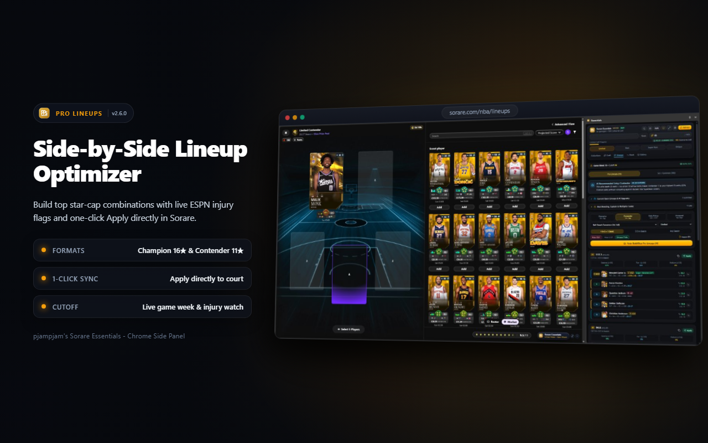

<p align="center">
  
</p>

<h1 align="center">pjampjam's Sorare Essentials</h1>

<p align="center">
  <strong>v2.6.0</strong> - Independent Manifest V3 Chrome Side Panel & Dashboard for Sorare NBA
</p>

<p align="center">
  <a href="https://github.com/essentially-pjampjam/sorare-essentials/issues/new">Send Feedback / Report Bug</a>
  &nbsp;|&nbsp;
  <a href="DISCLAIMER.md">Disclaimer</a>
  &nbsp;|&nbsp;
  <a href="PRIVACY.md">Privacy Policy</a>
  &nbsp;|&nbsp;
  <a href="LICENSE">MIT License</a>
</p>

---

**pjampjam's Sorare Essentials** helps Sorare NBA managers compare live collection costs per Essence, track League Quests, model Craft EV odds, build star-cap Pro & Common Set lineups, scout market bargains, and evaluate Vault/Sell decisions directly from Chrome's Side Panel or a full-width dashboard tab.

## Screenshots




## Features

- **Collections & Essence Optimizer (`Collections`):**
  - Ranks incomplete NBA team collections by cheapest instant-buy cost per Essence (`EUR` / `USD` / `ETH`) while separating Instant Buy (`SingleSaleOffer`) and 1st-owner (`PrimaryOffer`) / auction listings.
  - Tracks live NBA League Collect Quests (`Draft 26'`, `26' Non-Playoffs`, `26' Conference Finals`, `26' Playoffs`, `Full Collection`) with Nearing Goal Radar alerts and exact shortfall wallet checks.
- **Craft EV & Clues Advisor (`Craft`):**
  - Calculates tier draw probabilities, Expected Value, and filtered target pools (`Min L10`, `Stars`, teams/positions) as Sorare craft clues narrow the board.
- **Pro & Common Lineup Optimizer (`Lineups`):**
  - Supports **Champion (`16★` Cap)**, **Contender (`11★` Cap)**, **Daily Pickup (`120 + MVP`)**, and **Uncapped**, with `4 In-Season + 1 Classic`, `5/5 In-Season`, and `Any Season` rules.
  - Accurately models Pro positional scoring without obsolete Captain multipliers, while reserving **MVP** as the cap-free superstar slot in `Daily Pickup (120 + MVP)`.
  - Includes live ESPN injury badges, 4-day Gameweek schedules, positional DvP difficulty, **Multi-Competition 3-Entry Portfolio** disjoint solver, **Hybrid Budget Lineup Builder** (`Owned + Market`), **Dual Buy Advisor**, and **1-Click Apply** / on-page stepper HUD on `sorare.com`.
  - Dedicated **Set / Common** view with **Daily Picker** threshold hit odds and **1-8 Team Squad / Solo** builder.
- **Deals Sniper & Gallery Vault ROI (`Deals`, `Gallery`):**
  - Scans instant-buy deals, `1ST` primary offers, and live auctions with configurable Quest/player price watchlist alerts (`chrome.alarms`).
  - Tracks `On Fire` / `Cold` L5-vs-L10 trends, Star Tier Shift candidates, safe-to-sell liquidity, and dynamic Vault vs. Sell ROI calculations.
- **Built-in Release Notes & Feedback:**
  - Click the header version pill (`v2.6.0`) to open the What's New dialog or send bug reports and feature requests directly via GitHub Issues.

## Install From Source (Chrome Unpacked)

1. Clone or download this repository:
   ```bash
   git clone https://github.com/essentially-pjampjam/sorare-essentials.git
   cd sorare-essentials
   ```
2. Install dependencies and build:
   ```bash
   npm install
   npm run build
   ```
3. Open `chrome://extensions` in Google Chrome.
4. Enable **Developer mode** (top-right toggle).
5. Click **Load unpacked** and select the generated `dist/` folder.
6. Open `sorare.com/nba` and click the extension icon to launch the Side Panel (or click expand for Full Dashboard mode).

## Development & Verification

```bash
npm run typecheck   # TypeScript strict check (tsc --noEmit)
npm test            # Pure calculator & queue unit tests (vitest run)
npm run build       # Production Vite bundle -> dist/
npm run check       # Runs typecheck + test + build
npm run zip         # Builds dist/ and packages Chrome Web Store zip
```

## Privacy & Non-Affiliation

- **100% Client-Side:** Your handle, preferences, watchlist alerts, optional personal Sorare API key, and short-lived cache live exclusively in local `chrome.storage.local`. Zero analytics or third-party tracking servers are used. See [PRIVACY.md](PRIVACY.md).
- **Unofficial Companion Tool:** Not affiliated with or endorsed by Sorare SAS or the NBA. All market prices, EV numbers, and lineup projections are informational estimates - use at your own risk and always verify directly on `sorare.com`. See [DISCLAIMER.md](DISCLAIMER.md).

## Feedback & Support

- Found a bug or want to suggest an NBA feature? [Open an issue on GitHub](https://github.com/essentially-pjampjam/sorare-essentials/issues/new).
- Want to support development? Check `@pjampjam` on Sorare NBA or open the in-app **Support** modal.

Released under the [MIT License](LICENSE).
