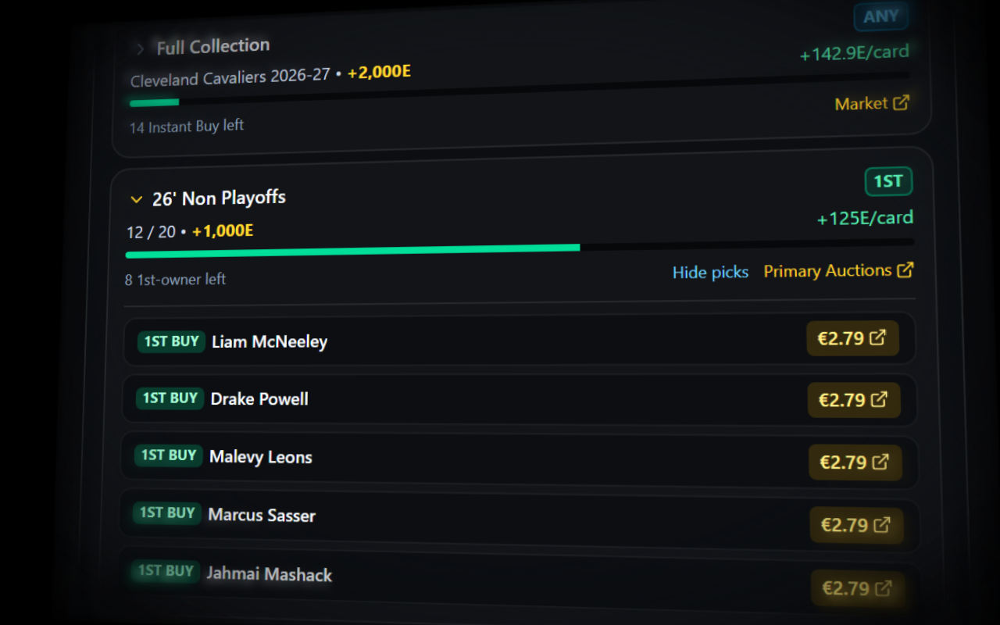
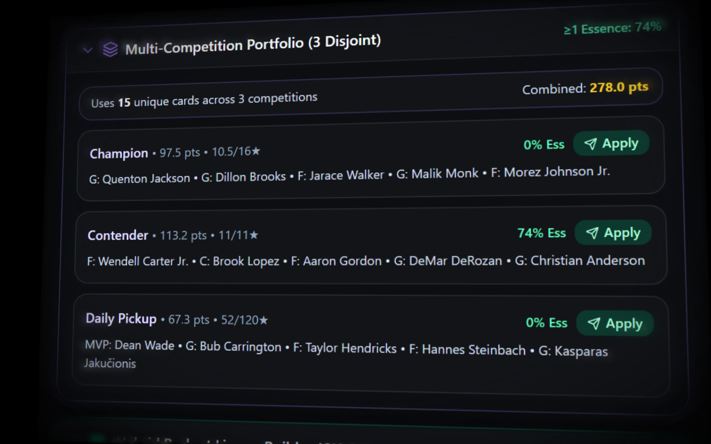

<p align="center">
  
</p>

<h1 align="center">pjampjam's Sorare NBA Essentials</h1>

<p align="center">
  <strong>v2.7.5</strong> - Unofficial Chrome Side Panel & Dashboard for Sorare NBA
</p>

<p align="center">
  <a href="https://github.com/essentially-pjampjam/sorare-nba-essentials/releases/latest"><strong>Download latest release</strong></a>
  &nbsp;|&nbsp;
  <a href="https://github.com/essentially-pjampjam/sorare-nba-essentials/issues/new">Send Feedback / Report Bug</a>
  &nbsp;|&nbsp;
  <a href="DISCLAIMER.md">Disclaimer</a>
  &nbsp;|&nbsp;
  <a href="PRIVACY.md">Privacy Policy</a>
  &nbsp;|&nbsp;
  <a href="LICENSE">MIT License</a>
</p>

---

Hey - welcome! I originally put this Chrome extension together for myself because too many basic convenience tools in fantasy sports are locked behind subscriptions and paywalls. Eventually it got useful enough that I figured I might as well clean it up and share it publicly in case anyone else finds parts of it handy.

## Install in 1 Minute (no coding)

1. Download `pjampjams-sorare-nba-essentials-v2.7.5.zip` from the [latest release](https://github.com/essentially-pjampjam/sorare-nba-essentials/releases/latest) and unzip it.
2. Open `chrome://extensions` and turn on **Developer mode** (top right).
3. Click **Load unpacked** and pick the unzipped folder.
4. Open `sorare.com/nba`, click the extension icon, type your Sorare username and press **Scan**.

Optional: paste your own Sorare API key in Settings (or click the **Fast Mode** lightning bolt button in the top bar) for much faster loading (it stays on your computer, encrypted with WebCrypto AES-GCM). The lightning bolt button turns blue when Fast Mode is active.

Tip: the **Set | Limited | Rare | Super Rare | Unique** bar at the top switches the whole panel between Set (Common) and Pro.

## A Quick Heads-Up (Early Version & Disclaimer)

- **Built for convenience, not an unfair advantage:** Everything here just pulls public Sorare NBA / ESPN data you can already check yourself and organizes it in one place to save clicks (collection math, Essence per currency, Craft pool odds, lineup cap combos, ending-soon `< 1h` auctions, and gallery filters). It never auto-buys, auto-bids, or auto-submits anything for you.
- **Take what's useful:** Some features or numbers might make a lot of sense for how you play, while other parts might not fit your style at all - feel free to ignore whatever you don't need.
- **Early release - feedback appreciated:** This is still an early version and Sorare tweaks rules and pricing regularly. If you spot a bug, weird math, or have an idea that would save you time, please [open an issue on GitHub](https://github.com/essentially-pjampjam/sorare-nba-essentials/issues/new).
- **Rate limits in Public Mode:** Without a personal Sorare API key, Sorare caps unauthenticated GraphQL calls, so big actions like pricing every historical collection (`Load All`) can take 2-4 minutes. Smaller batches (`Top 3` in ~4s or `26-27` sets in ~45s) stay much quicker, and if you ever want 60x speed you can paste your own local-only API key in Settings.
- **How it was built:** I used AI coding tools to help write and iterate on parts of this project, and 100% of the source code is right here in the repo so anyone can inspect, audit, or customize it.

## Screenshots







## What It Includes

- **Collections & Essence Finder (`Collections`):**
  - Ranks incomplete NBA team collections by instant-buy cost per Essence (`EUR` / `USD` / `ETH`) using grouped `SingleSaleOffer` and `PrimaryOffer` floors, while keeping Instant Buy separate from `< 24h` live Quest auctions (and `< 1h` ending-soon auctions in Deals).
  - Tracks live NBA League Collect Quests (`Draft 26'`, `26' Non-Playoffs`, `26' Conference Finals`, `26' Playoffs`, `Full Collection`) with Nearing Goal Radar bars, a Liquid Essence Glass Tube meter, and wallet shortfall checks.
- **Craft EV & Clue EVOI Advisor (`Craft`):**
  - Estimates tier draw odds and pool values as Sorare craft clues narrow down the remaining pool (`Min L10`, `Stars`, team, position), and recommends the **Best Clue to Use** by Expected Value of Information (EVOI) and entropy reduction.
- **Pro Lineup Optimizer (`Lineups`):**
  - Covers **Champion (`16★` Cap)**, **Contender (`11★` Cap)**, Arena rooms and **Uncapped**, with `4 In-Season + 1 Classic`, `5/5 In-Season`, and `Any Season` rules (enforcing max 4 players per NBA team).
  - **Real rewards** read live from Sorare: Reward, Cash $ and Podium odds per contest, live Dollar ($) & Essence EV, visual Reward Preview chips, plus a recommended entry.
  - Lineup strategies (Max projection, Safe floor, High ceiling) optimized directly in the solver, with 5-card Sorare artwork preview strips, micro-SVG `p10-mean-p90` range bars, and manual **Lock (Must-Start)** / **Skip Card** controls.
  - **Current Pro Progress**: your live and upcoming lineups (read from your logged-in Sorare tab) with rank, points, projected rank and reward status, plus a Game Week history.
  - Live ESPN injuries (with a Position-Aware **Who Steps Up** beneficiary panel), per-game Vegas & back-to-back peak order statistics, Game Week and Daily Reset countdowns, Pre-Lock Lineup Health Check reminders, and a side-by-side lineup helper on `sorare.com`.
- **Daily Play guide:** synced with Sorare's live daily pickers (Daily Picker, Playmaker Picker, Double Double, Rebounds and more) on today's slate, with Negative Binomial count-stat odds, Best odds / Safe / Risk-upside picks, and a Mine / Not owned / All filter.
- **Set (Common) tools** (Set button in the top bar):
  - **Solo** builder: full 5-card teams under the `16★` cap with Holo (`+20%`) / Shiny (`+10%`) bonuses and stage odds; *Prioritize today* aims to finish a stage the same day.
  - **Squad Activity**: who has a team in the live stage, the best 3 teams that count, and the points still needed.
  - **Pack & Mission Advisor**: Set Essence glass tube meter targeting your next pack, free Daily Pack, Bronze+ progress, Live Today and special packs (found automatically on your Shop tab) and each pack's chance of a 3★+ card.
- **Deals Sniper, Gallery & Guides (`Deals`, `Gallery`, `Guides`):**
  - Scans unique instant-buy deals, `1ST` Primary Offers, and realistic auctions ending within 1 hour, plus optional 10-minute watchlist alerts (`chrome.alarms`).
  - **Sealing Deal Finder** (Deals): cheapest market cards ranked by Sorare's live Sealing Points per euro, with an exact 0/1 Knapsack budget planner.
  - Gallery tracks `On Fire` / `Cold` L5-vs-L10 form trends, Star Tier Shift candidates, Vault vs. Sell comparisons, and a **Vault Unseal & Reseal Profit Detector** (respecting the 14-day cooldown); sealed cards are hidden by default.
  - **Duplicate Sell Advisor**: which extra copies to sell (Pro) or scrap (Set), keeping Shiny / Holo, in-lineup cards and young or injured players worth holding.
  - **Guides & Strategy Hub**: interactive Sorare NBA Box-Score Calculator, 2026-27 caps & stars guide, Vault playbook, Set F2P roadmap, persistent Pre-Lock GW Checklist, and Math & Privacy FAQ.

## Install From Source (developers)

1. Clone or download this repository:
   ```bash
   git clone https://github.com/essentially-pjampjam/sorare-nba-essentials.git
   cd sorare-nba-essentials
   ```
2. Install dependencies and build:
   ```bash
   npm install
   npm run build
   ```
3. Open `chrome://extensions` in Google Chrome.
4. Turn on **Developer mode** (top right).
5. Click **Load unpacked** and choose the `dist/` folder.
6. Visit `sorare.com/nba` and click the extension icon to open the Side Panel (or click the expand icon for the full dashboard tab).

## Scripts

```bash
npm run typecheck   # TypeScript strict check
npm test            # Unit tests (vitest)
npm run build       # Production Vite bundle -> dist/
npm run check       # typecheck + test + build
npm run zip         # Build dist/ and package zip
```

## Privacy & Support

- **Local only:** Settings, watchlist alerts, optional personal Sorare API key, and short-lived cache stay exclusively in `chrome.storage.local` on your machine. There is no backend server or tracking. See [PRIVACY.md](PRIVACY.md) and [DISCLAIMER.md](DISCLAIMER.md).
- **Say hello or support:** Ideas and bug reports go straight to [GitHub Issues](https://github.com/essentially-pjampjam/sorare-nba-essentials/issues/new). Optional trades/tips: my Sorare club is [sorare.com/nba/my-club/pjampjam](https://sorare.com/nba/my-club/pjampjam) (also in the in-app **Support** dialog).

Best of luck with your lineups and crafts!

Released under the [MIT License](LICENSE).
