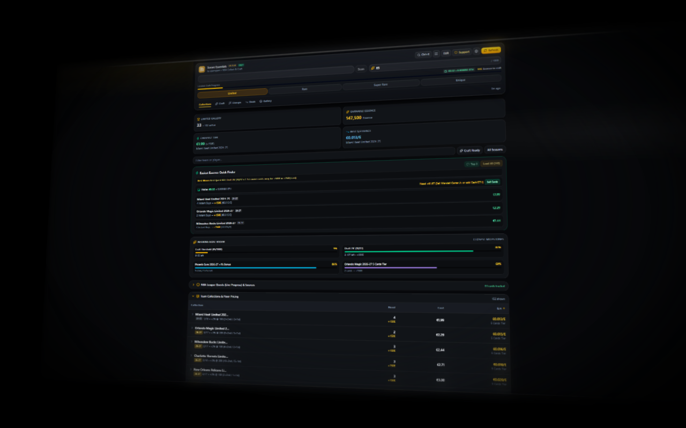
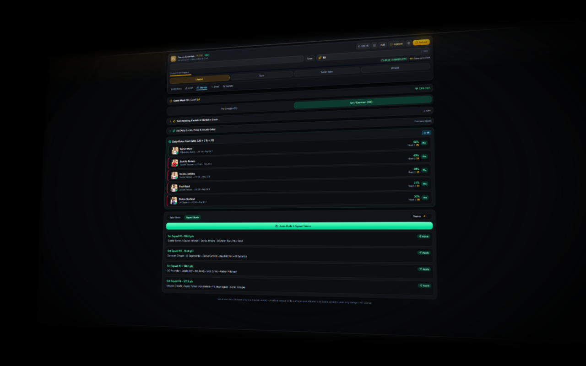

<p align="center">
  
</p>

<h1 align="center">pjampjam's Sorare Essentials</h1>

<p align="center">
  <strong>v2.6.1</strong> - Unofficial Chrome Side Panel & Dashboard for Sorare NBA
</p>

<p align="center">
  <a href="https://github.com/essentially-pjampjam/sorare-essentials/issues/new">Send Feedback / Report Bug</a>
  &nbsp;|&nbsp;
  <a href="DISCLAIMER.md">Disclaimer</a>
  &nbsp;|&nbsp;
  <a href="PRIVACY.md">Privacy Policy</a>
  &nbsp;|&nbsp;
  <a href="LICENSE">MIT License</a>
</p>

---

Hey - welcome! I originally put this Chrome extension together for myself because too many basic convenience tools in fantasy sports are locked behind subscriptions and paywalls. Eventually it got useful enough that I figured I might as well clean it up and share it publicly in case anyone else finds parts of it handy.

## A Quick Heads-Up (Early Version & Disclaimer)

- **Built for convenience, not an unfair advantage:** Everything here just pulls public Sorare NBA / ESPN data you can already check yourself and organizes it in one place to save clicks (collection math, Essence per currency, Craft pool odds, lineup cap combos, ending-soon `< 1h` auctions, and gallery filters). It never auto-buys, auto-bids, or auto-submits anything for you.
- **Take what's useful:** Some features or numbers might make a lot of sense for how you play, while other parts might not fit your style at all - feel free to ignore whatever you don't need.
- **Early release - feedback appreciated:** This is still an early version and Sorare tweaks rules and pricing regularly. If you spot a bug, weird math, or have an idea that would save you time, please [open an issue on GitHub](https://github.com/essentially-pjampjam/sorare-essentials/issues/new).
- **Rate limits in Public Mode:** Without a personal Sorare API key, Sorare caps unauthenticated GraphQL calls, so big actions like pricing every historical collection (`Load All`) can take 2-4 minutes. Smaller batches (`Top 3` in ~4s or `26-27` sets in ~45s) stay much quicker, and if you ever want 60x speed you can paste your own local-only API key in Settings.
- **How it was built:** I used AI coding tools to help write and iterate on parts of this project, and 100% of the source code is right here in the repo so anyone can inspect, audit, or customize it.

## Screenshots







## What It Includes

- **Collections & Essence Finder (`Collections`):**
  - Ranks incomplete NBA team collections by instant-buy cost per Essence (`EUR` / `USD` / `ETH`) using grouped `SingleSaleOffer` and `PrimaryOffer` floors, while keeping Instant Buy separate from `< 1h` live auctions.
  - Tracks live NBA League Collect Quests (`Draft 26'`, `26' Non-Playoffs`, `26' Conference Finals`, `26' Playoffs`, `Full Collection`) with Nearing Goal Radar bars and wallet shortfall checks.
- **Craft EV & Clues Advisor (`Craft`):**
  - Estimates tier draw odds and pool values as Sorare craft clues narrow down the remaining pool (`Min L10`, `Stars`, team, position).
- **Pro & Common Lineup Optimizer (`Lineups`):**
  - Covers **Champion (`16★` Cap)**, **Contender (`11★` Cap)**, **Daily Pickup (`120 + MVP`)**, and **Uncapped**, with `4 In-Season + 1 Classic`, `5/5 In-Season`, and `Any Season` rules.
  - Keeps **MVP** as the cap-free slot in `Daily Pickup (120 + MVP)` without fake Pro Captain multipliers.
  - Includes live ESPN injury status, 4-day Gameweek schedules, positional DvP, Multi-Competition Disjoint Portfolio builder, Hybrid Budget builder (`Owned + Market`), Dual Buy Advisor, and a side-by-side lineup helper on `sorare.com`.
  - Includes a **Set / Common** view for **Daily Picker** threshold odds and **1-8 Team Squad / Solo** builders.
- **Deals Sniper & Gallery (`Deals`, `Gallery`):**
  - Scans unique instant-buy deals, `1ST` Primary Offers, and realistic auctions ending within 1 hour, plus optional 10-minute watchlist alerts (`chrome.alarms`).
  - Tracks `On Fire` / `Cold` L5-vs-L10 form trends, Star Tier Shift candidates, and Vault vs. Sell comparisons.

## Install From Source (Chrome Unpacked)

1. Clone or download this repository:
   ```bash
   git clone https://github.com/essentially-pjampjam/sorare-essentials.git
   cd sorare-essentials
   ```
2. Install dependencies and build:
   ```bash
   npm install
   npm run build
   ```
3. Open `chrome://extensions` in Google Chrome.
4. Turn on **Developer mode** (top right).
5. Click **Load unpacked** and choose the `dist/` folder.
6. Visit `sorare.com/nba` and click the extension icon to open the Side Panel (or click the expand icon for the full dashboard tab).

## Scripts

```bash
npm run typecheck   # TypeScript strict check
npm test            # Unit tests (vitest)
npm run build       # Production Vite bundle -> dist/
npm run check       # typecheck + test + build
npm run zip         # Build dist/ and package zip
```

## Privacy & Support

- **Local only:** Settings, watchlist alerts, optional personal Sorare API key, and short-lived cache stay exclusively in `chrome.storage.local` on your machine. There is no backend server or tracking. See [PRIVACY.md](PRIVACY.md) and [DISCLAIMER.md](DISCLAIMER.md).
- **Say hello or support:** Ideas and bug reports go straight to [GitHub Issues](https://github.com/essentially-pjampjam/sorare-essentials/issues/new). Optional trades/tips (`@pjampjam`) are inside the in-app **Support** dialog.

Best of luck with your lineups and crafts!

Released under the [MIT License](LICENSE).
